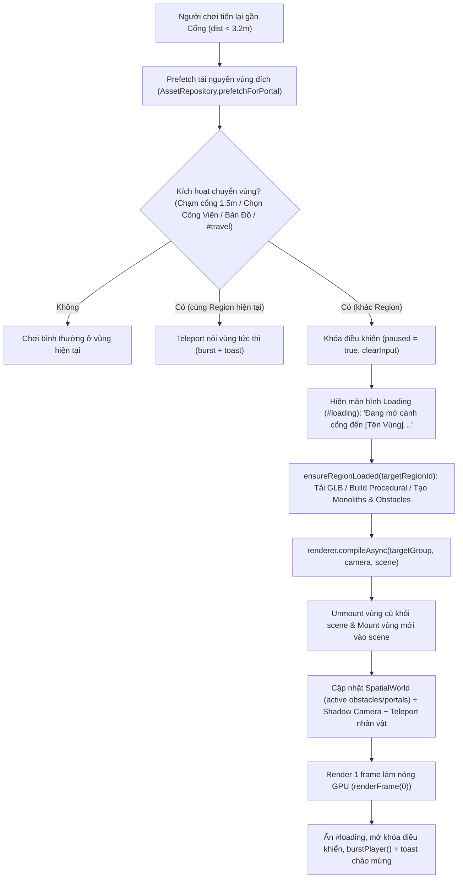
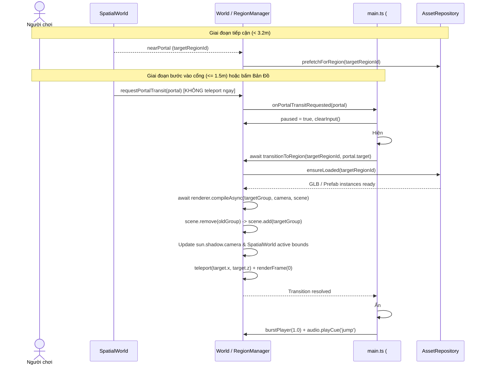

# Báo Cáo Nghiên Cứu Kỹ Thuật: Tách Mỗi Vùng Đất Thành Scene Riêng & Màn Hình Loading Khi Qua Cổng Dịch Chuyển

> **Trạng thái:** Nghiên cứu kiến trúc (`/research`) — chưa chỉnh sửa mã nguồn thực thi.  
> **Đối tượng áp dụng:** `World`, `SpatialWorld`, `WorldSession`, `AssetRepository`, `ArchimedesZoneBuilder`, `FarmSanctuary`, `ProceduralLandBuilder`, và luồng điều phối UI trong `main.ts`.

---

## 1. Tóm Tắt Điều Hành (Executive Summary)

Đề xuất **tách mỗi vùng đất thành một Scene/Region nạp theo nhu cầu (On-Demand)** và **hiển thị màn hình loading khi nhân vật bước vào Cổng Dịch Chuyển đến khi vùng đích nạp xong** là **hoàn toàn khả thi và giải quyết đúng điểm nghẽn hiệu năng lớn nhất hiện nay của dự án**.

Qua kiểm toán trực tiếp mã nguồn Three.js (`v0.180.0`) và các module thế giới 3D trong repo:

1. **Hiện trạng gây tốn tài nguyên:** Toàn bộ vương quốc hiện được dựng vào **1 `THREE.Scene` khổng lồ duy nhất** ([`src/world/World.ts#L121`](file:///d:/github/hoc-toan-3d/src/world/World.ts#L121)). Ngay khi đồng bộ cấu hình vùng đất, `World.renderDynamicZones()` đồng loạt tải và dựng `PARK_SANCTUARY` (`park.glb` nặng **6.45 MB**, 141 meshes / 289 nodes), `FARM_SANCTUARY` (`farm.glb` **448.6 KB** + 5 prefab cỏ hoa + 140 cụm cỏ + 80 bụi cây + 10 thú cưng), các đảo `PROCEDURAL_SANCTUARY`, cùng 40+ Bia Đá Tri Thức — ngay cả khi người chơi đang đứng ở Làng Khởi Đầu.
2. **Chi phí ngầm ngay cả khi ẩn bằng `.visible = false`:** Trong mã nguồn Three.js `v0.180.0`, `WebGLRenderer.render()` gọi `scene.updateMatrixWorld()` ([`WebGLRenderer.js#L1536`](file:///d:/github/hoc-toan-3d/node_modules/three/src/renderers/WebGLRenderer.js#L1536)), và `Object3D.updateMatrixWorld()` **không kiểm tra `this.visible`** ([`Object3D.js#L1126-L1164`](file:///d:/github/hoc-toan-3d/node_modules/three/src/core/Object3D.js#L1126-L1164)). Do đó, giữ các vùng đất khác trong `this.scene` với `visible = false` vẫn làm CPU duyệt đệ quy ma trận cho hàng trăm node không nhìn thấy mỗi khung hình, đồng thời `World.ts` vẫn chạy `farmSanctuary.update()`, quay tinh thể 40+ bia đá và kiểm tra va chạm trên một mảng vật cản phẳng toàn cầu.
3. **Khuyến nghị kiến trúc tối ưu (Single `THREE.Scene` + Active `RegionScene` Container):** Thay vì tạo nhiều `THREE.Scene` rời rạc (gây phức tạp khi phải reparent `player`, đèn, sương mù và pool hạt hiệu ứng vì mỗi `Object3D` chỉ thuộc về 1 cha duy nhất theo [`Object3D.js#L741-L745`](file:///d:/github/hoc-toan-3d/node_modules/three/src/core/Object3D.js#L741-L745)), nên giữ **1 `THREE.Scene` gốc** chứa thành phần dùng chung (`player`, ánh sáng, sương mù, `SceneBatchPool` particle pools) và tách mỗi vùng đất thành một **Region Container (`THREE.Group`) độc lập** — **chỉ mount duy nhất 1 vùng đất đang đứng vào `this.scene` tại một thời điểm**, kết hợp `renderer.compileAsync()` để tránh khựng frame đầu tiên và thu hẹp vùng chiếu bóng `sun.shadow.camera` theo từng vùng.
4. **Phân ranh giới hợp lý:** **Làng Khởi Đầu + Cây Cầu Tình Bạn + Vườn Hoa Tri Thức** nối trực tiếp với nhau qua sông (`X = 4..10`) nên gộp chung làm vùng gốc (`CORE_VILLAGE_GARDEN`). Tất cả các vùng nối qua Cổng Dịch Chuyển (**Đền Cổng Archimedes**, từng **Ốc Đảo Chuyên Đề**, **Công Viên Xanh**, **Nông Trại**, và từng **Đảo Tùy Biến**) đều tách thành các vùng nạp lười (lazy-loaded) riêng biệt.

---

## 2. Phân Tích Hiện Trạng Từ Mã Nguồn (Primary-Source Codebase Audit)

### 2.1. Kiến trúc "1 Scene hợp nhất" và nạp đồng loạt (Eager Loading)

| Thành phần | Hành vi hiện tại | Dẫn chứng mã nguồn |
| :--- | :--- | :--- |
| **Scene & Camera** | Khởi tạo 1 `THREE.Scene` và 1 `PerspectiveCamera(42, 1, .1, 400)` chứa mọi vùng đất ở các cụm tọa độ xa nhau (`X ∈ [-45, 190]`, `Z ∈ [-60, 60]`). | [`World.ts#L120-L122`](file:///d:/github/hoc-toan-3d/src/world/World.ts#L120-L122), [`World.ts#L286-L307`](file:///d:/github/hoc-toan-3d/src/world/World.ts#L286-L307) |
| **Kích hoạt nạp hàng loạt** | Ngay khi `WorldSession.launch()` hoặc `applyRemotePayload()` chạy, `syncPayloadIntoWorld()` gọi `world.renderDynamicZones(...)`. | [`WorldSession.ts#L212-L214`](file:///d:/github/hoc-toan-3d/src/boot/WorldSession.ts#L212-L214), [`WorldSession.ts#L278-L306`](file:///d:/github/hoc-toan-3d/src/boot/WorldSession.ts#L278-L306) |
| **Công Viên Xanh (`PARK_SANCTUARY`)** | Tải `park.glb` (**6,759,840 bytes ≈ 6.45 MB**, 141 meshes, 289 nodes), tính Box3, tạo obstacle & clone material cho 20 cây ngay trong `renderDynamicZones()`. | [`World.ts#L910-L915`](file:///d:/github/hoc-toan-3d/src/world/World.ts#L910-L915), [`World.ts#L1422-L1551`](file:///d:/github/hoc-toan-3d/src/world/World.ts#L1422-L1551), [`meshCatalog.json#L56-L62`](file:///d:/github/hoc-toan-3d/public/data/meshCatalog.json#L56-L62) |
| **Nông Trại (`FARM_SANCTUARY`)** | Tải `farm.glb` (**448.6 KB**) + 5 prefab cỏ/hoa/bụi cây (`~92 KB/file`), tạo 140 cụm cỏ hoa + 80 bụi cây viền (`InstancedMesh`) và 10 `FarmAnimalEntity` ngay trong `renderDynamicZones()`. | [`World.ts#L962-L968`](file:///d:/github/hoc-toan-3d/src/world/World.ts#L962-L968), [`World.ts#L1380-L1420`](file:///d:/github/hoc-toan-3d/src/world/World.ts#L1380-L1420), [`FarmSanctuary.ts#L61-L84`](file:///d:/github/hoc-toan-3d/src/world/farm/FarmSanctuary.ts#L61-L84), [`FarmSanctuary.ts#L228-L275`](file:///d:/github/hoc-toan-3d/src/world/farm/FarmSanctuary.ts#L228-L275) |
| **Đảo Tùy Biến (`PROCEDURAL_SANCTUARY`)** | Gọi `proceduralLandBuilder.buildLand()` cho từng đảo và `await Promise.all(proceduralTasks)` ngay lúc đồng bộ, nạp 12–38 prefab GLB mỗi đảo. | [`World.ts#L985-L1030`](file:///d:/github/hoc-toan-3d/src/world/World.ts#L985-L1030), [`World.ts#L1123-L1125`](file:///d:/github/hoc-toan-3d/src/world/World.ts#L1123-L1125), [`ProceduralLandBuilder.ts#L30-L131`](file:///d:/github/hoc-toan-3d/src/world/procedural/ProceduralLandBuilder.ts#L30-L131) |
| **5 Ốc Đảo Hồ (`cozy_lake.glb`)** | `selectLakeSanctuariesToLoad()` trì hoãn khi `playerX <= 35`, nhưng vừa bước qua Đền Cổng Archimedes (`X = 60`), **cả 5 đảo** đều clone `cozy_lake.glb` (`387,268 bytes`, 66 meshes, 136 nodes mỗi bản → tổng **330 meshes / 680 nodes**) và gắn vĩnh viễn vào `this.scene`. | [`World.ts#L42-L51`](file:///d:/github/hoc-toan-3d/src/world/World.ts#L42-L51), [`World.ts#L1279-L1378`](file:///d:/github/hoc-toan-3d/src/world/World.ts#L1279-L1378), [`meshCatalog.json#L48-L54`](file:///d:/github/hoc-toan-3d/public/data/meshCatalog.json#L48-L54) |
| **40+ Bia Đá Tri Thức** | Toàn bộ bia đá của tất cả các đảo được thêm thẳng vào `this.scene` ngay khi khởi tạo/đồng bộ; mỗi bia đá tạo 7 mesh con (gồm `beam` bán trong suốt `transparent: true, depthWrite: false`). | [`ArchimedesZoneBuilder.ts#L128-L198`](file:///d:/github/hoc-toan-3d/src/world/ArchimedesZoneBuilder.ts#L128-L198), [`World.ts#L1164-L1172`](file:///d:/github/hoc-toan-3d/src/world/World.ts#L1164-L1172) |

### 2.2. Chi phí CPU & GPU mỗi khung hình (60Hz Overhead)

1. **Cập nhật logic 60Hz cho vùng không đứng ở đó:**
   - Trong `renderFrame()`, vòng lặp vật lý cố định 60Hz luôn gọi `this.farmSanctuary.update(this.FIXED_DT, this.player.position)` bất kể người chơi đang ở Làng Khởi Đầu hay Archimedes ([`World.ts#L1838-L1840`](file:///d:/github/hoc-toan-3d/src/world/World.ts#L1838-L1840)). Hàm này chạy AI/animation cho toàn bộ 10 con vật mỗi tick (`FarmSanctuary.ts#L681-L807`).
   - Mỗi frame render tiếp tục duyệt qua: 10 bông hoa (`World.ts#L1870-L1891`), 20 cây công viên (`World.ts#L1894-L1898`), toàn bộ 40+ bia đá & cổng (`ArchimedesZoneBuilder.ts#L263-L288`), và kiểm tra khoảng cách trigger nông trại (`World.ts#L1913-L1925`).
2. **Kiểm tra va chạm tuyến tính toàn cầu:**
   - `SpatialWorld.canMove(x, z)` duyệt tuần tự 2 mảng phẳng `this.obstacles` và `this.dynamicObstacles` chứa mọi cây, tảng đá, hàng rào, bia đá của **tất cả các đảo đã nạp** trên từng bước di chuyển ([`SpatialWorld.ts#L258-L263`](file:///d:/github/hoc-toan-3d/src/world/SpatialWorld.ts#L258-L263)).
3. **Bóng đổ (Shadow Map) bị dàn trải trên diện tích quá lớn:**
   - Đèn `DirectionalLight` dùng shadow map `1024×1024` nhưng frustum chiếu bóng cố định rất rộng: `left: -75, right: 220, top: 90, bottom: -90, near: 1, far: 260` ([`World.ts#L234-L237`](file:///d:/github/hoc-toan-3d/src/world/World.ts#L234-L237)). Hộp chiếu bao phủ **295 m × 180 m** khiến mật độ texel chỉ đạt **~0.29 m/pixel** (bóng bị răng cưa/mờ), đồng thời GPU vẫn phải xét mọi mesh `castShadow` nằm trong vùng chiếu này ở Shadow Pass.
4. **Duyệt ma trận Three.js đối với node ẩn:**
   - Khi một vùng bị ẩn bằng `visible = false` (`World.ts#L844-L865`, `#L1134-L1158`), `WebGLRenderer.projectObject()` ([`WebGLRenderer.js#L1711`](file:///d:/github/hoc-toan-3d/node_modules/three/src/renderers/WebGLRenderer.js#L1711)) và `WebGLShadowMap.renderObject()` ([`WebGLShadowMap.js#L344`](file:///d:/github/hoc-toan-3d/node_modules/three/src/renderers/webgl/WebGLShadowMap.js#L344)) bỏ qua việc vẽ. Tuy nhiên `WebGLRenderer.render()` luôn gọi `scene.updateMatrixWorld()` ở đầu frame ([`WebGLRenderer.js#L1536`](file:///d:/github/hoc-toan-3d/node_modules/three/src/renderers/WebGLRenderer.js#L1536)), và `Object3D.updateMatrixWorld()` ([`Object3D.js#L1126-L1164`](file:///d:/github/hoc-toan-3d/node_modules/three/src/core/Object3D.js#L1126-L1164)) luôn đệ quy xuống tất cả `children` mà **không kiểm tra `this.visible`**. Chỉ khi **gỡ khỏi `this.scene`** (`scene.remove(regionGroup)`), chi phí duyệt này mới thực sự bằng 0.

### 2.3. Hiện trạng Cổng Dịch Chuyển, Prefetch & Màn hình Loading

- **Dịch chuyển đồng bộ tức thời:** `SpatialWorld.checkPortalTransit(dt)` ([`SpatialWorld.ts#L430-L449`](file:///d:/github/hoc-toan-3d/src/world/SpatialWorld.ts#L430-L449)) kiểm tra `dist <= portal.triggerRadius` (1.5 m) và gọi ngay `this.teleport(portal.target.x, portal.target.z)` trong physics step, không chờ vùng đích dựng xong tài nguyên 3D.
- **Lỗi chuỗi ID trong Prefetch (`AssetRepository.prefetchForPortal`):**
  - `World.ts#L1929-L1932` gọi `this.assets.prefetchForPortal(nearPortal.id)` khi người chơi ở trong phạm vi `3.2 m` quanh cổng.
  - Tuy nhiên `AssetRepository.prefetchForPortal()` ([`AssetRepository.ts#L190-L206`](file:///d:/github/hoc-toan-3d/src/world/assets/AssetRepository.ts#L190-L206)) chỉ kiểm tra `portalId.includes('lake')`, trong khi ID cổng thực tế tới 5 Ốc Đảo Hồ là `hub_to_z1`..`hub_to_z5` ([`SpatialWorld.ts#L52-L69`](file:///d:/github/hoc-toan-3d/src/world/SpatialWorld.ts#L52-L69)) và `hub_to_z${z.id}` ([`World.ts#L1055`](file:///d:/github/hoc-toan-3d/src/world/World.ts#L1055)). Do đó **`map:cozy_lake` không bao giờ được prefetch trước** (dù test `tests/asset_repository.test.ts#L17` giả lập tên `'archimedes_to_lake'`).
  - Ngược lại, điều kiện `portalId.includes('park') || portalId.includes('village')` ở dòng 191 lại khiến các cổng **quay về làng** (`z8_to_village_farm` tại [`World.ts#L81`](file:///d:/github/hoc-toan-3d/src/world/World.ts#L81), hoặc `z7_to_village`) kích hoạt tải nhầm `map:park` (`6.45 MB`) khi người chơi đang đứng ở Nông Trại hoặc Công Viên!
- **Dịch chuyển từ Bản Đồ & Nút `#travel`:** Các nút `.zone-teleport-btn` ([`main.ts#L1101-L1113`](file:///d:/github/hoc-toan-3d/src/main.ts#L1101-L1113)), `.park-select-portal-btn` ([`main.ts#L583-L595`](file:///d:/github/hoc-toan-3d/src/main.ts#L583-L595)), và nút `#travel` ([`main.ts#L1184-L1200`](file:///d:/github/hoc-toan-3d/src/main.ts#L1184-L1200)) đều gọi thẳng `world.teleport(x, z)` đồng bộ.
- **Màn hình Loading sẵn có:** Phần tử `<div id="loading" class="loading">` đã có sẵn trong DOM ([`main.ts#L132`](file:///d:/github/hoc-toan-3d/src/main.ts#L132)) với CSS `position: absolute; inset: 0; z-index: 50` (`z-index` cao hơn `.topbar` `5`, `.welcome` `10`, `.touch-controls` `25`, `.toast` `30`) và hiệu ứng `.loading-logo-box` (`pulse`) ([`src/style.css#L1`](file:///d:/github/hoc-toan-3d/src/style.css#L1), [`src/style.css#L1212-L1226`](file:///d:/github/hoc-toan-3d/src/style.css#L1212-L1226)), cùng quy tắc `[hidden]{display:none!important}` (chưa có CSS transition fade) và `@media(prefers-reduced-motion:reduce)`. Lưu ý nhỏ: khi `start()` chạy ([`main.ts#L401-L402`](file:///d:/github/hoc-toan-3d/src/main.ts#L401-L402)), code đang ghi đè `innerHTML` bằng `<div class="spinner"></div>` trong khi `.spinner` chưa có định nghĩa CSS trong `src/style.css`; nên tái sử dụng `.loading-logo-box` kèm thẻ `<strong id="loading-title">` để cập nhật nội dung ngữ cảnh mà không mất giao diện thương hiệu.

---

## 3. Đánh Giá Tác Động Hiệu Năng (Performance Impact Matrix)

| Chỉ số hiệu năng | Hiện trạng (All-in-One Scene) | Khi tách Region Scene + Portal Loading |
| :--- | :--- | :--- |
| **Tải mạng & Parse GLB lúc vào game** | Tự động tải `park.glb` (6.45 MB) + `farm.glb` (448.6 KB) + 5 prefabs (~460 KB) + procedural prefabs ngay khi sync `CONFIG`. | **0 KB GLB bản đồ** khi ở Làng Khởi Đầu + Vườn Hoa (chỉ tải avatar người chơi đang chọn theo ADR). |
| **Số node & mesh trong `this.scene`** | Làng + Vườn Hoa + Hub + 5 × `cozy_lake` (680 nodes) + `park` (289 nodes) + `farm` + 40+ bia đá cùng nằm trong Scene Graph. | Chỉ chứa **duy nhất 1 vùng đất hiện tại** (giảm ~70%–85% node khi ở Làng, Công Viên hoặc từng Ốc Đảo). |
| **Chi phí duyệt ma trận (`updateMatrixWorld`)** | Duyệt mọi vùng đất (kể cả vùng ẩn `visible = false`) mỗi frame 60fps. | Chỉ duyệt các node thuộc vùng đất đang mount trong `this.scene`. |
| **Vòng lặp CPU 60Hz** | Chạy `farmSanctuary.update()`, quay 40+ bia đá, kiểm tra mảng `obstacles` của toàn bộ vương quốc. | Chỉ chạy `update()` và kiểm tra `obstacles` của **đúng vùng đất hiện tại**. |
| **Chất lượng & tốc độ Shadow Map** | `1024×1024` trải rộng `295m × 180m` (~0.29 m/texel), shadow pass quét nhiều vùng. | Thu hẹp `shadow.camera` còn `~64m × 64m` theo vùng hiện tại → **nét bóng gấp ~4.5×** và ít vertex shadow pass hơn hẳn. |
| **Khựng hình khi lần đầu qua cổng** | Nếu `cozy_lake` chưa kịp tải xong lúc tới đảo, hiển thị đĩa trụ tạm rồi mới giật khung hình khi parse & compile shader. | Màn hình `#loading` che mượt toàn bộ quá trình tải GLB + dựng mesh + `compileAsync()` shader; khung hình đầu tiên vào vùng mới ổn định ngay ở 60fps. |

---

## 4. Kiến Trúc Đề Xuất: Phân Vùng Scene Theo Vùng Đất (Region-Isolated Scene Graph)

### 4.1. Ranh giới phân chia các Vùng Đất (Region Partitioning Boundaries)

Không nên tách Làng Khởi Đầu và Vườn Hoa Tri Thức thành 2 scene riêng, vì hai khu vực này **nối liền bằng Cây Cầu Tình Bạn bắc qua sông** ([`src/data/config.ts#L6`](file:///d:/github/hoc-toan-3d/src/data/config.ts#L6), [`SpatialWorld.ts#L215-L219`](file:///d:/github/hoc-toan-3d/src/world/SpatialWorld.ts#L215-L219)): người chơi đi bộ trực tiếp qua cầu và đứng bên này sông vẫn quan sát thấy bờ bên kia. Ngược lại, mọi khu vực đi qua **Cổng Dịch Chuyển** đều biệt lập về không gian và tầm nhìn.

```
[Region 0: CORE_VILLAGE_GARDEN]  (Mặc định khi vào game)
 ├── Làng Khởi Đầu (X: -21..4) + Tiệm Tạp Hóa + Milo
 ├── Sông & Cây Cầu Tình Bạn (X: 4..10)
 └── Vườn Hoa Tri Thức (X: 10..34, 10 cây hoa) + Cổng sang Archimedes (X: 32, Z: 0)
        │
        ├──(Cổng Công Viên Làng Khởi Đầu X=-19.5, Z=0)──▶ [Region: PARK:{zoneId}] (park.glb + 20 Cây Tri Thức)
        ├──(Cổng Gỗ Đồng Quê X=-8, Z=14)────────────────▶ [Region: FARM:{zoneId}] (farm.glb + 10 thú cưng)
        └──(Cổng Vườn Hoa X=32, Z=0)────────────────────▶ [Region: ARCHIMEDES_HUB] (Đền Cổng X=60, Z=0)
                                                               │
                                                               ├──(hub_to_z1..z5)──▶ [Region: LAKE:{zoneId}] (1 bản cozy_lake.glb + ~8 bia đá)
                                                               └──(hub_to_z{id})──▶ [Region: PROCEDURAL:{zoneId} | CUSTOM:{zoneId}]
```

**Lợi ích rõ rệt với 5 Ốc Đảo Chuyên Đề (`GRID_SANCTUARY` / `CIRCLE_SANCTUARY`):**  
Hiện tại 5 ốc đảo dùng `cozy_lake.glb` được đặt ở `(110, -60)`, `(150, -60)`, `(110, 60)`, `(150, 60)`, `(190, 0)` chỉ để tránh đè lên nhau trong 1 scene chung. Khi tách thành từng Region riêng biệt, tại một thời điểm chỉ mount **1** bản sao `cozy_lake.glb` (66 meshes) và **8** bia đá của riêng ốc đảo đó thay vì 5 bản sao (330 meshes) và 40 bia đá.

### 4.2. So sánh 2 phương án kỹ thuật trong Three.js `v0.180.0`

| Tiêu chí | Phương án A: Nhiều thực thể `THREE.Scene` riêng biệt | Phương án B (Khuyến nghị): 1 `THREE.Scene` gốc + Active `RegionScene` Container (`THREE.Group`) |
| :--- | :--- | :--- |
| **Cách hoạt động** | Mỗi vùng giữ một `new THREE.Scene()`. `renderer.render(activeRegion.scene, camera)`. | `World.scene` giữ cố định Đèn, Fog, `player`, `SceneBatchPool` particle pools. Mỗi vùng là một `RegionContainer` (`THREE.Group`); chỉ gắn duy nhất vùng đang đứng vào `this.scene`. |
| **Xử lý đối tượng dùng chung (`player`, hạt hiệu ứng, ánh sáng)** | Phải gọi `activeScene.add(player)`, chuyển `HemisphereLight`, `DirectionalLight` + `sun.target` ([`three.core.js#L46259`](file:///d:/github/hoc-toan-3d/node_modules/three/build/three.core.js#L46259)), `fog`, và phải viết lại `SceneBatchPool` vì `ensureEffectPools()` chỉ khởi tạo 1 lần cho 1 `effectsScene` (`if (!this.effectsScene \|\| this.sparkMesh) return;` tại [`SceneBatchPool.ts#L410`](file:///d:/github/hoc-toan-3d/src/world/SceneBatchPool.ts#L410)). Ngoài ra `Object3D.add()` tự gọi `removeFromParent()` ([`Object3D.js#L743`](file:///d:/github/hoc-toan-3d/node_modules/three/src/core/Object3D.js#L743)). | **Không cần reparent** `player`, ánh sáng hay particle pools. Chỉ cần giữ `sparkMesh`/`trailPools` ở `this.scene` và gọi `this.scene.remove(oldGroup)` + `this.scene.add(newGroup)`. |
| **Tối ưu GPU & CPU** | Tối đa (chỉ có node của scene đang render). | **Tương đương 100%** Phương án A: khi `oldGroup` đã `remove()` khỏi `this.scene`, `WebGLRenderer` không duyệt `updateMatrixWorld`, không `projectObject`, không render Shadow Pass cho vùng cũ. |
| **Shader Pre-compilation** | Phải `compileAsync(nextScene, camera)` với ánh sáng đã chuyển sang `nextScene`. | Dùng trực tiếp `renderer.compileAsync(nextRegionGroup, camera, this.scene)` ([`WebGLRenderer.js#L1301-L1408`](file:///d:/github/hoc-toan-3d/node_modules/three/src/renderers/WebGLRenderer.js#L1301-L1408)) — Three.js tự lấy ánh sáng & fog từ `targetScene` (`this.scene`) để biên dịch shader cho `nextRegionGroup` trước khi mount! |
| **Tương thích kiến trúc & Unit Tests** | Phá vỡ ràng buộc `this.renderer.render(this.scene, this.camera)` trong [`tests/world_render_pipeline.test.ts#L9`](file:///d:/github/hoc-toan-3d/tests/world_render_pipeline.test.ts#L9). | Giữ nguyên hợp đồng `this.renderer.render(this.scene, this.camera)` và cấu trúc `WorldHandle`. |

**Kết luận chọn Phương án B:** Đạt toàn bộ lợi ích hiệu năng của việc tách Scene trong Three.js mà không tạo rủi ro đồng bộ ánh sáng/hiệu ứng hay reparenting nhân vật.

### 4.3. Thiết kế cấu trúc dữ liệu `WorldRegion` (Deep Module Boundary)

Mỗi vùng đất được đóng gói thành một descriptor/controller thống nhất (`WorldRegion`):

- `id: RegionId` (ví dụ `'core'`, `'hub'`, `'zone:1'`, `'zone:7'`, ...)
- `group: THREE.Group` — gốc 3D của riêng vùng đất (chỉ tạo nội dung khi `ensureLoaded()` chạy).
- `shadowBounds: { cx: number; cz: number; halfExtent: number }` — vùng bao để tự động co giãn `sun.shadow.camera` khi mount.
- `obstacles: Obstacle[]` — danh sách vật cản **chỉ của riêng vùng này**, nạp vào `SpatialWorld.setActiveRegionData(...)` khi vùng được kích hoạt.
- `portals: PortalLink[]` — danh sách cổng xuất phát từ vùng này (mỗi cổng mang thêm `targetRegionId: RegionId`).
- `update(dt: number, time: number, playerPos: THREE.Vector3): void` — chỉ chạy logic động của vùng đang hoạt động (ví dụ: gió cối xay + hoa + Milo cho `'core'`; `farmSanctuary.update()` cho `'zone:farm'`; quay tinh thể bia đá cho riêng các bia đá của `'zone:1'`).
- `dispose?(): void` — giải phóng group cục bộ nếu áp dụng chính sách thu hồi bộ nhớ khi đổi vùng trên thiết bị RAM thấp.

---

## 5. Thiết Kế Luồng Cổng Dịch Chuyển & Màn Hình Loading

### 5.1. Sơ đồ trạng thái & tuần tự chuyển cảnh (Portal Loading Lifecycle)





### 5.2. Cải tiến cơ chế Prefetch & Chống nhấp nháy Loading (Anti-Flicker)

1. **Sửa lỗi nhận diện cổng trong `AssetRepository.prefetchForPortal()` ([`AssetRepository.ts#L190-L206`](file:///d:/github/hoc-toan-3d/src/world/assets/AssetRepository.ts#L190-L206)):**
   - Gắn trường `targetRegionKind?: 'park' | 'lake' | 'farm' | 'procedural' | 'core' | 'hub'` trực tiếp lên `PortalLink` thay vì đoán bằng `portalId.includes('lake')` / `portalId.includes('village')`.
   - Khi đứng gần cổng đi tới Ốc Đảo Hồ (`hub_to_z1`..`hub_to_z5`), `prefetchForPortal` sẽ tải trước `map:cozy_lake` đúng như thiết kế ban đầu.
   - Khi đứng gần cổng quay về (`z*_to_village`, `z*_to_hub`), không tải nhầm `map:park`.
   - Với `FARM_SANCTUARY`, prefetch luôn cả `map:farm` lẫn 5 prefab cỏ/hoa/bụi cây (`prefab:park_grass002`, `prefab:park_grass003`, `prefab:park_flowers002`, `prefab:park_flowers003`, `prefab:park_bush002`) đang được `FarmSanctuary.load()` yêu cầu ([`FarmSanctuary.ts#L62-L69`](file:///d:/github/hoc-toan-3d/src/world/farm/FarmSanctuary.ts#L62-L69)).
2. **Đảm bảo UI `#loading` kịp vẽ (Paint Yield) trước khi xử lý nặng:**
   - Khi vừa set `$('loading').hidden = false`, chờ 1 frame (`await new Promise(r => requestAnimationFrame(() => r()))`) trước khi chạy bước dựng scene / `compileAsync`, đảm bảo trình duyệt kịp render lớp phủ `#loading` lên màn hình thay vì bị khóa main thread khi parse GLB.
   - Áp dụng **minimum visible duration ngắn hoặc CSS fade-out (ví dụ 200–250 ms)** nếu vùng đã cache sẵn trong RAM để tránh hiện tượng màn hình chớp lóe trong 16 ms gây khó chịu cho học sinh tiểu học.
3. **Nạp sai / Mất mạng (Graceful Error Recovery):**
   - Trong khối `try/catch` chuyển vùng: nếu tải GLB thất bại do rớt mạng ở lần đầu vào đảo (chưa có trong `3d-models-cache` của PWA), `AssetRepository` tự fallback sang placeholder hoặc đĩa dự phòng (ADR 0009 / `ProceduralLandBuilder`), hoặc nếu lỗi nghiêm trọng thì trả về vùng cũ + mở khóa `paused = false` + hiện toast thông báo thân thiện, tuyệt đối không kẹt vĩnh viễn ở màn hình `#loading`.

---

## 6. Xử Lý Các Edge Cases & Ràng Buộc Kỹ Thuật

### 6.1. Khởi Tạo Vị Trí Trì Hoãn (Deferred Spawn — ADR 0007)

Theo [`docs/adr/0007-saved-player-coordinates-and-deferred-spawn.md`](file:///d:/github/hoc-toan-3d/docs/adr/0007-saved-player-coordinates-and-deferred-spawn.md) và [`WorldSession.ts#L263-L318`](file:///d:/github/hoc-toan-3d/src/boot/WorldSession.ts#L263-L318):
- Nếu người chơi lưu tọa độ ở Làng Khởi Đầu hoặc Vườn Hoa: boot thẳng vào Region `CORE_VILLAGE_GARDEN` như hiện nay (`0 KB` GLB bản đồ).
- Nếu người chơi lưu tọa độ ở một vùng đất xa (ví dụ `Zone 4`, `Công Viên Xanh`, hoặc `Nông Trại`):
  1. `WorldSession.launch()` xác định `targetRegionId` tương ứng với `initialPosition` từ cấu hình `this._zones` (hoặc chờ `bootSync()` trả về cấu hình vùng nếu `initialPosition` nằm ngoài `CORE_VILLAGE_GARDEN`).
  2. Giữ `#loading` hiển thị trên `start()` cho tới khi **chỉ duy nhất vùng đất chứa `initialPosition`** được `ensureLoaded()` + mount xong, rồi đặt nhân vật ngay tại tọa độ an toàn (`resolveSafeSpawn`).
  3. Không cần tạm spawn ở Làng Khởi Đầu rồi nạp toàn bộ 5 ốc đảo + công viên + nông trại như trước.

### 6.2. Bản Đồ Vương Quốc (`openArchimedesMapDialog`) & Nút `#travel`

Kiểm tra [`src/main.ts#L696-L1146`](file:///d:/github/hoc-toan-3d/src/main.ts#L696-L1146) cho thấy Bản Đồ đang tham chiếu trực tiếp một số thuộc tính 3D của `world`:
- `world?.flowers[i]?.position` ([`main.ts#L833`](file:///d:/github/hoc-toan-3d/src/main.ts#L833)) → có thể thay bằng `FLOWER_COORDS[i]` ([`SpatialWorld.ts#L72-L75`](file:///d:/github/hoc-toan-3d/src/world/SpatialWorld.ts#L72-L75)).
- `world?.parkTrees[i]?.position` ([`main.ts#L881`](file:///d:/github/hoc-toan-3d/src/main.ts#L881)) → nếu người chơi chưa từng vào Công Viên, `world.parkTrees` sẽ rỗng (`[]`); cần fallback sang `computeProceduralEntityPositions('PARK_SANCTUARY', ...)` ([`src/data/remoteTypes.ts#L145-L165`](file:///d:/github/hoc-toan-3d/src/data/remoteTypes.ts#L145-L165)).
- `world?.farmSanctuary?.animals` ([`main.ts#L718, L758, L929, L940, L966`](file:///d:/github/hoc-toan-3d/src/main.ts#L929-L966)) → khi Nông Trại chưa nạp 3D, số lượng thú mặc định là `qList.length || 10`, và nút `"🚀 Đến chỗ thú cưng"` nếu chọn từ ngoài Nông Trại nên dịch chuyển tới cổng đến Nông Trại `(z.center.x - 8, z.center.z + 10)` hoặc sau khi `ensureLoaded('farm')` hoàn tất mới đọc `animalEntity.root.position`.
- Mọi nút `.zone-teleport-btn` trên Bản Đồ, `.park-select-portal-btn` và nút `#travel` ([`main.ts#L1184-L1200`](file:///d:/github/hoc-toan-3d/src/main.ts#L1184-L1200)) đều phải đi qua chung hàm điều phối `teleportWithRegionLoading(x, z, targetName)` để đảm bảo màn hình `#loading` luôn hiện nếu đích đến thuộc về một Region khác.

### 6.3. Tối ưu Shadow Camera động theo vùng hiện tại

Hiện tại `sun` được cấu hình cố định một lần trong constructor của `World` ([`World.ts#L234-L237`](file:///d:/github/hoc-toan-3d/src/world/World.ts#L234-L237)) mà chưa gắn `sun.target` vào `this.scene`. Theo [`LightShadow.updateMatrices`](file:///d:/github/hoc-toan-3d/node_modules/three/build/three.core.js#L45317-L45354), Three.js đọc cả `light.matrixWorld` lẫn `light.target.matrixWorld` để tính hướng chiếu bóng. Do đó, khi mount mỗi Region cần:
- Gắn `this.scene.add(sun.target)` một lần lúc khởi tạo `World` (hoặc gọi `sun.target.updateMatrixWorld()` mỗi khi di chuyển mục tiêu).
- Đặt `sun.target.position.set(region.center.x, 0, region.center.z)` và `sun.position.set(region.center.x - 24, 45, region.center.z + 12)`.
- Co hộp `sun.shadow.camera` (`left/right/top/bottom`) vừa khít bán kính vùng đất (ví dụ `±36m` cho mỗi ốc đảo/công viên/nông trại, hoặc `[-30, 42]` theo trục X và `±25` theo trục Z cho `CORE_VILLAGE_GARDEN`), sau đó gọi `sun.shadow.camera.updateProjectionMatrix()` và `sun.target.updateMatrixWorld()`.

### 6.4. Quản lý bộ nhớ VRAM & Service Worker Cache (PWA)

1. **Chính sách giữ/xả tài nguyên 3D:**
   - Giữ lại cache gốc trong `AssetRepository` cho các asset nhẹ dùng lặp lại (`map:cozy_lake` 378 KB, `prefab:*` 20–92 KB).
   - Với các `RegionContainer` nặng ít quay lại liên tục (đặc biệt `PARK_SANCTUARY` với `park.glb` **6.45 MB**), `unmount()` gỡ `group` khỏi `this.scene` ngay lập tức để cắt 100% chi phí CPU/GPU; ngoài ra có thể bổ sung hàm `evictRegion(regionId)` gọi `dispose` các material clone (như `grayMaterial`/`coloredMaterial` của 20 cây công viên tại [`World.ts#L1497-L1513`](file:///d:/github/hoc-toan-3d/src/world/World.ts#L1497-L1513)) khi rời vùng hoặc khi vượt ngưỡng vùng đã cache (LRU cache 2–3 vùng gần nhất).
2. **Giới hạn Workbox Runtime Cache (`vite.config.ts#L48-L62`):**
   - Hiện cấu hình PWA `3d-models-cache` đặt `maxEntries: 50`. Vì thư mục `public/3dmodel/prefabs/` có tới ~180 file prefab + các map + avatar, nếu người chơi đi qua nhiều đảo `PROCEDURAL_SANCTUARY`, giới hạn `50` sẽ sớm đẩy các file map chính (`park.glb`, `cozy_lake.glb`, `farm.glb`) ra khỏi cache ngoại tuyến. Nên tăng `maxEntries` (ví dụ `150–200`) khi triển khai kiến trúc nạp theo vùng.

### 6.5. Ràng buộc với bộ kiểm thử hiện có (`tests/*.test.ts`)

Trong số 42 file test trong `tests/`, các nhóm sau chịu tác động trực tiếp và cần được bảo toàn hoặc cập nhật đồng bộ khi triển khai:
- [`tests/world_render_pipeline.test.ts#L7-L11`](file:///d:/github/hoc-toan-3d/tests/world_render_pipeline.test.ts#L7-L11): Kiểm tra trực tiếp sự tồn tại của `this.renderer.render(this.scene, this.camera)` trong `src/world/World.ts` và hàm `selectLakeSanctuariesToLoad` (Phương án B giữ nguyên lời gọi `render(this.scene, this.camera)`).
- [`tests/world_session.test.ts`](file:///d:/github/hoc-toan-3d/tests/world_session.test.ts), [`tests/saved_position.test.ts`](file:///d:/github/hoc-toan-3d/tests/saved_position.test.ts), [`tests/dynamic_world.test.ts`](file:///d:/github/hoc-toan-3d/tests/dynamic_world.test.ts), [`tests/zone_active_visibility.test.ts`](file:///d:/github/hoc-toan-3d/tests/zone_active_visibility.test.ts): Kiểm tra `SpatialWorld.isWithinLand`, `resolveSafeSpawn`, `setDynamicData`, ẩn hiện vùng theo `Active`/`StartAt`, và `WorldSession` deferred spawn. Nếu `SpatialWorld` phân vùng theo `activeRegionId`, hàm `resolveSafeSpawn(x, z)` vẫn phải nhận diện được tọa độ của mọi vùng đang `Active` trong `CONFIG` (để biết cần nạp vùng nào khi khởi động lại game), trong khi `canMove(x, z)` và `obstacles` chỉ kiểm tra trên vùng đang hoạt động.
- [`tests/asset_repository.test.ts#L15-L20`](file:///d:/github/hoc-toan-3d/tests/asset_repository.test.ts#L15-L20): Cần giữ tương thích hoặc cập nhật test cho `prefetchForPortal` với các ID thực tế `hub_to_z1`..`hub_to_z5` và `z*_to_village_farm`.
- [`tests/archimedes_builder.test.ts`](file:///d:/github/hoc-toan-3d/tests/archimedes_builder.test.ts), [`tests/park_sanctuary.test.ts`](file:///d:/github/hoc-toan-3d/tests/park_sanctuary.test.ts), [`tests/farm_sanctuary.test.ts`](file:///d:/github/hoc-toan-3d/tests/farm_sanctuary.test.ts), [`tests/game_loop_presenter.test.ts`](file:///d:/github/hoc-toan-3d/tests/game_loop_presenter.test.ts): Kiểm tra builder cổng/bia đá, cây công viên, nông trại, và `HudPresenter.reset()` khi chuyển vùng.

---

## 7. Lộ Trình Triển Khai Đề Xuất (Implementation Roadmap)

1. **Giai đoạn 1 — Chuẩn hóa Metadata Cổng & Prefetch (`SpatialWorld`, `AssetRepository`):**
   - Bổ sung `sourceRegionId` / `targetRegionId` và `targetKind` vào `PortalLink`.
   - Sửa `AssetRepository.prefetchForPortal()` nhận đúng `hub_to_z*` (`map:cozy_lake`), `farm` (`map:farm` + 5 flora prefabs), `park` (`map:park`), không prefetch nhầm ở cổng quay về.
   - Hỗ trợ trong `SpatialWorld` khả năng lọc `obstacles` và `portals` theo `activeRegionId`, trong khi giữ nguyên `resolveRegionForPoint(x, z)` cho Deferred Spawn và Bản Đồ.
2. **Giai đoạn 2 — Tách `World` thành `RegionSceneManager` (`src/world/`):**
   - Tách logic dựng cảnh của `CORE_VILLAGE_GARDEN`, `ARCHIMEDES_HUB`, `LAKE_SANCTUARY`, `PARK_SANCTUARY`, `FARM_SANCTUARY`, `PROCEDURAL_SANCTUARY` thành các `RegionBuilder` / `RegionNode` độc lập có `ensureLoaded()`, `mount(scene)`, `unmount(scene)`, `update(dt)`.
   - Tích hợp `sun.shadow.camera` co giãn động theo vùng đang mount và `renderer.compileAsync(group, camera, scene)`.
   - Chuyển `World.renderDynamicZones()` từ "dựng tất cả ngay lập tức" sang "chỉ đăng ký metadata vùng đất và nạp đúng vùng đang đứng".
3. **Giai đoạn 3 — Luồng Chuyển Cảnh Có Màn Hình Loading (`World` + `main.ts` + `WorldSession`):**
   - Thay bước tự teleport đồng bộ trong `SpatialWorld.checkPortalTransit` bằng phát sự kiện yêu cầu chuyển vùng `onPortalTransitRequested` (chỉ tự teleport nội bộ nếu cùng vùng).
   - Xây dựng `transitionToRegion(regionId, targetPos, label)` trong `main.ts` / `WorldSession`: khóa input → hiện `#loading` (với tên vùng đích & chống chớp) → `await world.activateRegion(...)` → teleport + `renderFrame(0)` → ẩn `#loading` + pháo hoa + toast.
   - Đấu nối lại nút `#travel`, bảng chọn công viên, Bản Đồ Vương Quốc (`openArchimedesMapDialog`), và luồng Deferred Spawn (ADR 0007).
4. **Giai đoạn 4 — Đo đạc & Tối ưu sau triển khai:**
   - Kiểm tra `renderer.info.render.calls`, `renderer.info.render.triangles`, `renderer.info.memory.geometries` trước/sau chuyển vùng bằng Chrome DevTools.
   - Chạy toàn bộ `npm test` và `npm run build`; tăng `maxEntries` trong `vite.config.ts` cho `3d-models-cache`.
